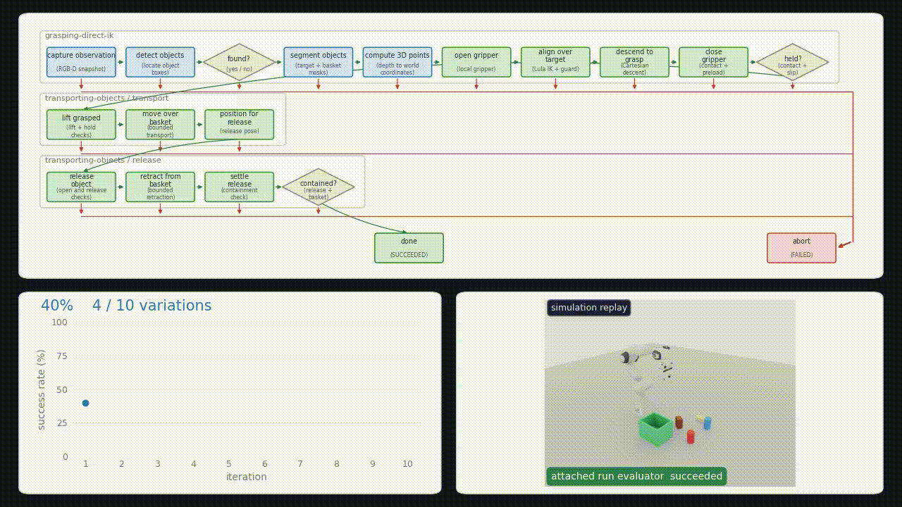

# Graph-as-Policy for Isaac Sim



This project is a focused recreation of the **Fulfill Grocery Orders** benchmark,
implementing a Graph-as-Policy controller for deterministic, single-object
grocery pick-and-place with a Franka robot in NVIDIA Isaac Sim. It samples
repeatable scene layouts, represents the task as explicit skill and action nodes
with success/failure routes, runs bounded simulator checks, and records structured
evidence for evaluation. The supporting Python tools also validate configuration
and inspect observations without starting Isaac Sim.

## Setup and basic use

From Windows PowerShell, with Python 3.10 or newer selected, create an
environment and install the package with its development tools:

```powershell
python -m venv .venv
.\.venv\Scripts\Activate.ps1
python -m pip install -e ".[dev]"
```

The main CLI can validate the checked-in YAML, inspect host readiness, and show
the deterministic inputs for an episode without launching the simulator:

```powershell
gap-isaac validate
gap-isaac doctor
gap-isaac sample --seed 0
gap-isaac plan-reset --seed 0 --target alphabet_soup
```

Full simulator workflows are Windows-native. The recorded platform configuration
targets Isaac Sim 6.1.0 and Isaac Lab 2.3.0, expects `ISAAC_SIM_PATH`, and selects
GPU index 0. Run files under `isaac/` with Isaac Sim's `python.bat`, not the
system interpreter; start with `gap-isaac doctor` to see which host settings are
available.

## API graph harness

The optional harness follows the coordinator, per subgraph skill agent and independent
checkpoint agent hierarchy. It keeps every graph revision and returns simulator state,
contact and checkpoint evidence for bounded refinement. Start with the offline check:

```powershell
.\.venv\Scripts\python.exe -m gap_harness.cli check
```

See [the harness guide](harness/README.md) for API opt in, version storage, rehearsal
commands, feedback design and other task manifests. The supplied executable adapter
uses the custom LIBERO grocery task; other tasks require deployed bindings and evaluation.

## References

1. K. Chen, S. Xie, L. Fu, J. Yu, W. Pacini, S. Bajamahal, H. Kim, J. Drake,
   D. Kim, H. Xue, J. Francis, C. Juette, P. Schaldenbrand, M. Y. Seker,
   R. Wickramarachchi, U. Yoo, G. Wang, A. Murali, B. Sundaralingam,
   S. S. Sastry, S. Huang, Y. Zhu, L. "Jim" Fan, and K. Goldberg,
   “GaP: A Graph-as-Policy Multi-Agent Self-Learning Harness For Variational
   Automation Tasks,” arXiv:2607.05369, 2026.
   [Paper](https://arxiv.org/pdf/2607.05369) ·
   [Project page](https://graph-robots.github.io/gap)
