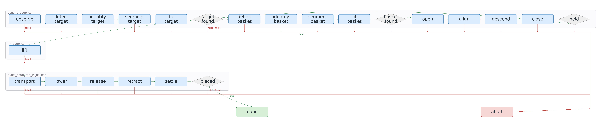

# Graph-as-Policy Robotic Task Recreation

A focused recreation of the [GaP](https://graph-robots.github.io/gap) approach to
robotic task execution. The project began with a Franka pick-and-place task in
NVIDIA Isaac Sim and now runs five scenarios in LIBERO, with multi-agent graph
generation, local visual perception, bounded controllers, and feedback-driven
refinement.

**Four scenarios reached 10/10 variations. Grocery fulfillment reached 9/10.**
These are small, task-specific evaluations, not a reproduction of the paper's
full benchmark or directly comparable leaderboard scores.

[](docs/visualizations/libero-native-object-local-qwen/libero-native-object-local-qwen-robot.mp4)

One successful native LIBERO-Object task 0 execution. The GIF is sped up to show
the complete grasp, lift, transport, and release; click it for the robot-only
video at recorded simulator speed. This single replay illustrates the task,
not the aggregate ten-trial result.

## Verified results

The completed October 19, 2026 campaigns used ten deterministic variations per
scenario. Scores below are from the final fully evaluated graph revision;
attempts include earlier generated candidates. Each revision was evaluated
against the same scenario variations during refinement.

| Scenario | Task | Final success | Graph attempts | Media |
| --- | --- | --- | --- | --- |
| Grocery pick-and-place | Place the designated blue cylinder into the basket | 10/10 (100%) | 1 | [Video](docs/visualizations/grocery-order/grocery-order-process.mp4) · [Graph](docs/visualizations/grocery-order/grocery-order-policy.png) |
| Grocery fulfillment | Place the requested grocery item into the basket with mixed object and layout changes | 9/10 (90%) | 10 | [Video](docs/visualizations/fulfillment/grocery-fulfillment-process.mp4) · [Graph](docs/visualizations/fulfillment/grocery-fulfillment-policy.png) |
| Two-item packing | Pack both requested items into the basket | 10/10 (100%) | 2 | [Video](docs/visualizations/packing/two-item-packing-process.mp4) · [Graph](docs/visualizations/packing/two-item-packing-policy.png) |
| Popcorn preparation proxy | Move the pan onto the burner and operate the knob sequence | 10/10 (100%) | 1 | [Video](docs/visualizations/popcorn/popcorn-preparation-process.mp4) · [Graph](docs/visualizations/popcorn/popcorn-preparation-policy.png) |
| Native LIBERO-Object task 0 | Place the textured alphabet-soup can into the woven basket | 10/10 (100%) | 1 | [Video](docs/visualizations/libero-native-object-local-qwen/libero-native-object-local-qwen-process.mp4) · [Graph](docs/visualizations/libero-native-object-local-qwen/libero-native-object-local-qwen-policy.png) |

Packing improved from 0/10 to 10/10 on its second candidate. Fulfillment improved
from 0/10 to 9/10 on its second candidate, then remained at 9/10 through the
ten-attempt limit. The other three campaigns passed on their first candidate.

The [media collection](docs/visualizations/README.md) includes robot-only clips
and full process videos. Process videos show the measured revision history,
success-rate chart, final simulation replay, and execution-linked graph routing.
The [results summary](docs/visualizations/results-summary.json) preserves session
IDs, version histories, graph and task hashes, failed variation indices, and local
evidence paths without committing large raw logs.

### Evaluation scope

- Four scenarios are custom approximations inspired by the paper's grocery,
  packing, and popcorn tasks. They are not the paper's original environments.
- The native result covers one official LIBERO-Object task with saved initial
  states 0–9. It is not a score for the complete LIBERO-Object suite.
- These variations were reused for graph refinement. They are not held-out
  generalization tests, and ten trials do not establish broad robustness.
- Fulfillment still has one failing variation. The pipeline is functional, but
  not every scenario achieved perfect success.
- Popcorn uses an abstract heating sequence, not thermal or food simulation.
- Other official LIBERO and LIBERO-Pro environments can be prepared and captured;
  capture support does not mean their tasks have evaluated graph bindings.

## How the harness works

1. A coordinator chooses three to eight physical-action subgraphs and assigns
   their skill contracts. Perception nodes belong inside these action-oriented
   subgraphs rather than standalone vision phases.
2. One skill-agent request fills each subgraph, and an independent checkpoint
   agent defines verifiable postconditions.
3. Local code validates the structured JSON, compiles the executable graph, and
   rejects unsupported actions or invalid routing before simulation.
4. Ten sequential simulator trials record action traces, predicate outputs,
   contacts, grasp and placement checks, and task-success evidence.
5. Failures are returned as structured feedback for another graph revision.
   The campaign stops at 10/10 or ten candidates. Infrastructure failures stop
   the run instead of being treated as policy mistakes.

The current generation configuration uses GPT-6.1 Sol with medium reasoning
through the loopback Codex compatibility proxy. Roles use separate requests with
explicit context; they are not persistent agents with hidden shared memory.
Every candidate keeps its own graph, validation, calls, feedback, and evaluation
artifacts under `results/harness/<session>/vNNNN/`.

<details>
<summary>Generated native-task policy with physical subgraphs and decision routes</summary>



</details>

At execution time, the graph invokes fixed local bindings rather than generating
or executing arbitrary Python. Hosted graph-generation agents are not needed
during execution; local Qwen is still used by visual identification nodes.

## Perception, motion, and verification

The current LIBERO path uses local `qwen3-vl-4b-instruct` in LM Studio. RGB-D
regions provide candidate image crops; Qwen selects object identities, masks
select depth pixels, and metric shape fitting supplies motion geometry. The
native task uses depth-connected foreground regions and declared shape priors;
the custom scenes use colored proxy regions. Identity or geometry failures
abort rather than falling back to simulator object poses.

LIBERO executes bounded Cartesian actions through the Panda OSC controller in
robosuite/MuJoCo. The earlier Isaac implementation uses Lula IK and bounded joint
motion. Contact and slip checks verify grasp stability; release and containment
checks verify placement. Native task success additionally requires the original
LIBERO goal after release. Simulator state is used for verification and diagnostics,
not as an oracle for visual motion targets.

### Reused and adapted

Selected upstream open-robot-skills instructions guide the skill agents. The
coordinator, skill-agent, and checkpoint hierarchy follows GaP, but this repository
implements its own lightweight JSON contracts, compiler, feedback loop, simulator
bindings, and visualizer; it does not run the paper's upstream generator.

The current evaluated path does not use upstream cuRobo motion planning or
DINO/SAM inference. Earlier saved-image DINO/SAM experiments remain separate
from the lighter local-Qwen and RGB-D region pipeline used for these results.

## Running the project

The evaluated setup is Windows-native with an RTX 5080. WSL is not required for
the demonstrated workflows. The core harness environment is `.venv`; LIBERO has
an isolated Python 3.10 environment at `.venv-libero`. Isaac and unrelated large
model workers should be stopped while running LIBERO with Qwen.

For a new checkout, install the core project and visualization dependencies:

```powershell
py -3.10 -m venv .venv
.\.venv\Scripts\python.exe -m pip install -e ".[dev,harness-tools]"
.\.venv\Scripts\python.exe -m pip install -r .\visualizer\requirements.txt
```

This alone does not install LIBERO, its pinned assets, or local vision weights.
See the [LIBERO guide](libero/README.md) for simulator setup and the
[harness guide](harness/README.md) for model configuration, credentials, generation,
evaluation, and feedback. Do not commit credentials or local caches.

With the configured Qwen model loaded and its LM Studio server running on
`http://127.0.0.1:1234/v1`, start the proxy and check the native task:

```powershell
.\.venv\Scripts\python.exe -m gap_harness.proxy start
.\.venv\Scripts\python.exe -m gap_harness.cli check --scenario native-object
```

Explicitly opt into hosted generation and simulator execution:

```powershell
.\scripts\windows\run-until-success.ps1 native-object
```

Other deployed selections are `grocery`, `fulfillment`, `packing`, and `popcorn`.
Each new campaign preserves every candidate and stops at 10/10 or ten attempts.
Hosted generation consumes the configured service's allowance or billing;
local simulation and local Qwen are separate from those generation requests.

### Visualizations and GIFs

Export an evaluated session with the existing visualizer. It reuses matching
footage or records one representative replay if needed; keep Qwen running if
that replay uses local visual identification.

```powershell
.\.venv\Scripts\python.exe .\visualizer\app.py libero
```

The offline media helper collects cached successful recordings into robot-only
MP4s and a compact evidence summary. It never starts models, simulation, or
hosted generation. Convert any local video to a bounded GIF with:

```powershell
.\.venv\Scripts\python.exe .\visualizer\media.py gif `
    .\docs\visualizations\libero-native-object-local-qwen\libero-native-object-local-qwen-robot.mp4 `
    --duration 60 --speed 3 --width 640 --fps 12
```

See the [visualizer guide](visualizer/README.md) for collection commands,
revision replay, and export options. Media conversion uses at most two encoder
threads and requires no GPU models. Add `--overwrite` to regenerate an existing GIF.

## Isaac origin and upstream environments

The original Isaac Sim 6.1.0 / Isaac Lab 2.3.0 path remains available. Set
`ISAAC_SIM_PATH` and run simulator scripts using Isaac's `python.bat`, not the
core interpreter. Read-only checks include `gap-isaac validate`, `gap-isaac doctor`,
`gap-isaac sample --seed 0`, and `gap-isaac plan-reset --seed 0 --target alphabet_soup`.

Official environment selection lives in the small `gap_libero.benchmarks` package
and reuses the central LIBERO backend, graph runner, perception, controllers,
verification, and recording. Original BDDL goals and saved states remain separate
from custom proxy scenarios.

```powershell
.\scripts\run-benchmark.ps1 -Prepare -Mode list
.\scripts\run-benchmark.ps1
```

Available selections include `libero-object`, `libero-spatial`, `libero-goal`,
`libero-10`, `libero-90`, `libero-pro-object`, and `libero-pro-swap`. Native
automatic generation/evaluation is currently deployed only for LIBERO-Object
task 0. The other tasks need matching perception and action bindings before they
can be evaluated automatically. LIBERO-Pro object and position-swap selections
are kept explicit rather than equated with the paper's combined benchmark label.

## References

- [GaP paper, arXiv:2607.05369](https://arxiv.org/pdf/2607.05369)
- [GaP project page](https://graph-robots.github.io/gap)
- [Open robot skills](https://github.com/graph-robots/open-robot-skills)
- [LIBERO](https://github.com/Lifelong-Robot-Learning/LIBERO)
