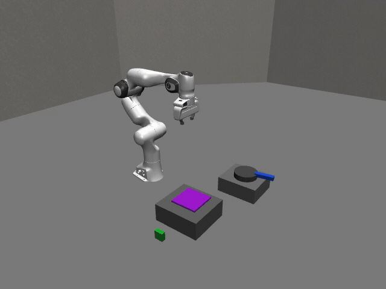
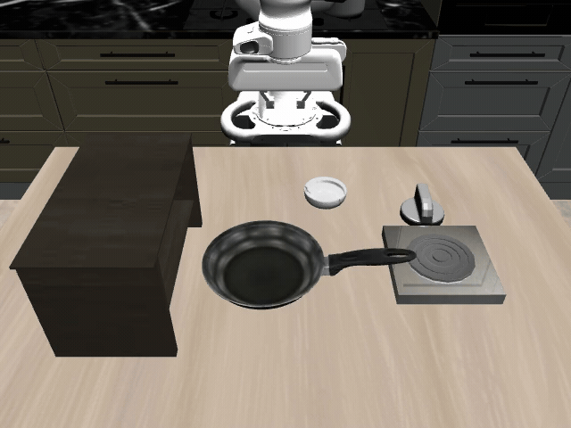
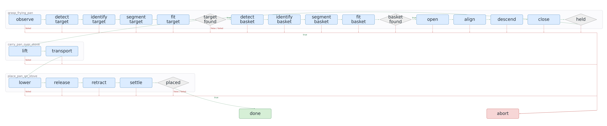

# Graph-as-Policy Robotics Benchmark

A focused recreation of the [GaP](https://graph-robots.github.io/gap) approach to
robotic task execution in **NVIDIA Isaac Sim** and **LIBERO**, with visual
perception, executable graph policies, bounded controllers, and simulator-based
verification.

| Simulator | Perception and execution | Task coverage |
| --- | --- | --- |
| NVIDIA Isaac Sim | Simulated RGB-D, saved-image detection and segmentation, Lula IK, bounded joint motion | Franka grocery pick-and-place with grasp, release, collision, and containment checks |
| LIBERO | Simulated RGB-D, local Qwen identification, metric geometry, Panda OSC motion in robosuite/MuJoCo | Four custom scenarios and four upstream task selections with multi-agent graph generation and evaluation |

**NVIDIA Isaac Sim:** Verified Franka grocery pick-and-place executions.

**LIBERO:** Upstream task selections score 10/10; custom scenarios score 9/10–10/10.
These are small, task-specific evaluations, not a reproduction of the paper's
full benchmark or directly comparable leaderboard scores.

## Verified results

### NVIDIA Isaac Sim

The Franka grocery task has saved successful graph executions using perceived
RGB-D geometry, grasp and lift verification, bounded transport, release, and
basket-containment checks. Per-run evidence is stored in `results/raw/`, with
layout-trial evidence in `results/layout-trials/`.

Isaac Sim execution receipts and LIBERO campaign scores are separate evidence
sets. The ten-variation tables below report LIBERO results only.

### LIBERO

Each evaluated LIBERO task uses ten deterministic development variations.
Policy iterations counts generated policy versions evaluated across those ten
variations, not simulator replays or implementation changes. A value of 1 means
no policy revision was needed to achieve the reported score.

[](docs/visualizations/libero-native-object-local-qwen/libero-native-object-local-qwen-robot.mp4)

One successful native LIBERO-Object task 0 execution. The GIF is sped up to show
the complete grasp, lift, transport, and release; click it for the robot-only
video at recorded simulator speed. This replay illustrates one execution,
not the aggregate ten-trial result.

#### Custom proxy scenarios

| Scenario | Task | Success | Policy iterations | Media |
| --- | --- | --- | --- | --- |
| Grocery pick-and-place | Place the designated blue cylinder into the basket | 10/10 (100%) | 1 | [Video](docs/visualizations/grocery-order/grocery-order-process.mp4) · [Graph](docs/visualizations/grocery-order/grocery-order-policy.png) |
| Grocery fulfillment | Place the requested grocery item into the basket with mixed object and layout changes | 9/10 (90%) | 10 | [Video](docs/visualizations/fulfillment/grocery-fulfillment-process.mp4) · [Graph](docs/visualizations/fulfillment/grocery-fulfillment-policy.png) |
| Two-item packing | Pack both requested items into the basket | 10/10 (100%) | 2 | [Video](docs/visualizations/packing/two-item-packing-process.mp4) · [Graph](docs/visualizations/packing/two-item-packing-policy.png) |
| Popcorn preparation proxy | Move the pan onto the burner and operate the knob sequence | 10/10 (100%) | 1 | [Video](docs/visualizations/popcorn/popcorn-preparation-process.mp4) · [Graph](docs/visualizations/popcorn/popcorn-preparation-policy.png) |

[](docs/visualizations/popcorn/popcorn-preparation-robot.mp4)

Popcorn preparation proxy in LIBERO. This accelerated preview shows an excerpt;
click the GIF for the complete robot execution.

#### Upstream environments

| Task selection | Task | Success | Policy iterations | Policy |
| --- | --- | --- | --- | --- |
| Native LIBERO-Object task 0 | Place the alphabet-soup can into the woven basket | 10/10 (100%) | 1 | [Graph](docs/visualizations/libero-native-object-local-qwen/libero-native-object-local-qwen-policy.png) |
| Published grocery fulfillment | Place the alphabet-soup can into the basket | 10/10 (100%) | 1 | [Graph](docs/visualizations/published-fulfillment/published-grocery-fulfillment-policy.png) |
| Published six-item packing | Pack all six grocery items using the upstream evaluator | 10/10 (100%) | 1 | [Graph](docs/visualizations/published-packing/published-six-item-packing-policy.png) |
| Published popcorn pan placement | Place the frying pan onto the stove | 10/10 (100%) | 1 | [Graph](docs/visualizations/published-popcorn/published-pan-placement-policy.png) |

The upstream popcorn task places the frying pan onto the stove using the policy
shown below.

[](docs/visualizations/published-popcorn/published-pan-placement-robot.mp4)

Complete pan-placement replay at accelerated speed. Click the GIF for the
recorded-speed video.

[](docs/visualizations/published-popcorn/published-pan-placement-policy.png)

Executed policy graph. Click to view the full-resolution image.

The native LIBERO task has a [process video](docs/visualizations/libero-native-object-local-qwen/libero-native-object-local-qwen-process.mp4)
and [policy graph](docs/visualizations/libero-native-object-local-qwen/libero-native-object-local-qwen-policy.png).
Pan evaluation evidence is saved in
`results/harness/published-popcorn-20261022-151547/v0001/evaluation-0006/feedback.json`.
All ten receipts confirm task success with a matching binding signature.

The [media collection](docs/visualizations/README.md) includes robot-only clips
and full process videos. Process videos combine measured success rates,
simulation footage, and execution-linked graph routing.
The [results summary](docs/visualizations/results-summary.json) preserves session
IDs, graph and task hashes, variation outcomes, and local
evidence paths without committing large raw logs.

### Evaluation scope

- Four scenarios are custom approximations inspired by the paper's grocery,
  packing, and popcorn tasks. They are not the paper's original environments.
- The native LIBERO result covers one official LIBERO-Object task with saved initial
  states 0–9. It is not a score for the complete LIBERO-Object suite.
- Each published GaP selection covers one task with saved initial states 0–9,
  not the complete upstream suite.
- These are development-set evaluations, not held-out generalization tests.
- Popcorn uses an abstract heating sequence, not thermal or food simulation.
- Other official LIBERO and LIBERO-Pro environments can be prepared and captured;
  capture support does not mean their tasks have evaluated graph bindings.

## How the harness works

Isaac Sim loads reference or validated generated graph policies through its local
graph validator and executes simulator-specific action bindings. The LIBERO
multi-agent harness generates and evaluates policies with the following roles:

1. A coordinator chooses three to eight physical-action subgraphs and assigns
   their skill contracts. Perception nodes belong inside these action-oriented
   subgraphs rather than standalone vision phases.
2. One skill-agent request fills each subgraph, and an independent checkpoint
   agent defines verifiable postconditions.
3. Local code validates the structured JSON, action contracts, and routing before
   compiling the executable graph for simulation.
4. Ten sequential simulator trials record action traces, predicate outputs,
   contacts, grasp and placement checks, and task-success evidence.
5. Structured evaluation feedback guides the next graph revision. The campaign
   stops at 10/10 or ten candidates.

Graph generation uses GPT-6.1 Sol with medium reasoning
through the loopback Codex compatibility proxy. Roles use separate requests with
explicit context; they are not persistent agents with hidden shared memory.
Every candidate keeps its own graph, validation, calls, feedback, and evaluation
artifacts under `results/harness/<session>/vNNNN/`.

<details>
<summary>Generated native-task policy with physical subgraphs and decision routes</summary>


</details>

At execution time, the graph invokes fixed local bindings rather than generating
or executing arbitrary Python. Hosted graph-generation agents are not needed
during execution; local Qwen supplies visual identification.

## Perception, motion, and verification

Execution validates perception, graph structure, grasp stability, collisions,
and task completion. Each run records verification evidence and diagnostic
feedback. Detailed safeguards and feedback handling are documented in the
[harness guide](harness/README.md) and [LIBERO guide](libero/README.md).

### NVIDIA Isaac Sim

Isaac Sim supplies simulated RGB-D observations through the read-only connector.
Grounding DINO and SAM3 operate sequentially on saved images in the isolated
perception environment; depth and camera calibration provide metric geometry.
Lula IK supplies joint targets for bounded Franka grasping and transport.
Execution checks include contact stability, relative slip, collisions, release,
and basket containment. Observation bundles, geometry artifacts, and execution
receipts preserve the evidence for each run.

### LIBERO

The LIBERO path uses local `qwen3-vl-4b-instruct` in LM Studio. RGB-D
regions provide candidate image crops; Qwen selects object identities, masks
select depth pixels, and metric shape fitting supplies motion geometry. The
native task uses depth-connected foreground regions and declared shape priors;
the custom scenes use colored proxy regions.

LIBERO executes bounded Cartesian actions through the Panda OSC controller in
robosuite/MuJoCo. Contact and slip checks verify grasp stability; release and
containment checks verify placement. Native task success additionally requires
the upstream LIBERO goal after release.

Both backends use simulator state for verification and diagnostics, not as an
oracle for visual motion targets. Simulator-specific bindings supply motion
without substituting one backend's results for the other's.

### Reused and adapted

Selected upstream open-robot-skills instructions guide the skill agents. The
coordinator, skill-agent, and checkpoint hierarchy follows GaP, but this repository
implements its own lightweight JSON contracts, compiler, feedback loop, simulator
bindings, and visualizer; it does not run the paper's upstream generator.

Isaac Sim uses Lula IK and bounded joint motion; LIBERO uses Panda OSC actions.
Neither execution path uses upstream cuRobo motion planning.

## Running the project

Both simulator setups are Windows-native with an RTX 5080. WSL is not required
for the demonstrated workflows. The core tooling uses `.venv`; Isaac Sim uses
its bundled Python launcher, and LIBERO uses the isolated Python 3.10 environment
`.venv-libero`. Run one simulator or perception-model worker at a time.

For a new checkout, install the core project and visualization dependencies:

```powershell
py -3.10 -m venv .venv
.\.venv\Scripts\python.exe -m pip install -e ".[dev,harness-tools]"
.\.venv\Scripts\python.exe -m pip install -r .\visualizer\requirements.txt
```

These commands install shared tooling, not either simulator or model weights.

### NVIDIA Isaac Sim

Use Isaac Sim 6.1.0 / Isaac Lab 2.3.0 and set `ISAAC_SIM_PATH` to the installation
directory. Simulator scripts use Isaac's `python.bat`, not the core interpreter.
The scene builder and graph validator provide the grocery execution workflow:

```powershell
$env:ISAAC_SIM_PATH = "C:\isaacsim"
.\.venv\Scripts\gap-isaac.exe doctor
.\scripts\windows\create-grocery-scene.ps1
.\scripts\windows\test-graph-pick-place.ps1 -Headless
```

The scene builder creates the USD stage used by the validator. Generated policies
can supply their graph, target geometry, basket geometry, and grasp evidence via
the validator's corresponding arguments. The read-only connector and
`capture-observation.ps1` provide saved RGB-D bundles for perception. Stop Isaac
Sim before loading perception models; do not run it alongside LIBERO.

### LIBERO

Use the [LIBERO guide](libero/README.md) for simulator setup and the
[harness guide](harness/README.md) for model configuration, credentials, generation,
evaluation, and feedback. Do not commit credentials or local caches.

With the configured Qwen model loaded and its LM Studio server running on
`http://127.0.0.1:1234/v1`, start the proxy and check the native task:

```powershell
.\.venv\Scripts\python.exe -m gap_harness.proxy start
.\.venv\Scripts\python.exe -m gap_harness.cli check --scenario native-object
```

Explicitly opt into hosted generation and simulator execution:

```powershell
.\scripts\windows\run-until-success.ps1 native-object
```

Other deployed selections are `grocery`, `fulfillment`, `packing`, and `popcorn`.
Each new campaign preserves every candidate and stops at 10/10 or ten attempts.
Hosted generation consumes the configured service's allowance or billing;
local simulation and local Qwen are separate from those generation requests.

### Visualizations and GIFs

Export an evaluated session with the existing visualizer. It reuses matching
footage or records one representative replay if needed; keep Qwen running if
that replay uses local visual identification.

```powershell
.\.venv\Scripts\python.exe .\visualizer\app.py libero
```

The offline media helper collects cached successful recordings into robot-only
MP4s and a compact evidence summary. It never starts models, simulation, or
hosted generation. Convert any local video to a bounded GIF with:

```powershell
.\.venv\Scripts\python.exe .\visualizer\media.py gif `
    .\docs\visualizations\libero-native-object-local-qwen\libero-native-object-local-qwen-robot.mp4 `
    --duration 60 --speed 3 --width 640 --fps 12
```

See the [visualizer guide](visualizer/README.md) for collection commands,
revision replay, and export options. Media conversion uses at most two encoder
threads and requires no GPU models. Add `--overwrite` to regenerate an existing GIF.

## Simulation environments

### NVIDIA Isaac Sim

USD scene builders configure the Franka arm, camera, grocery objects, and basket.
The read-only connector exposes observations without enabling remote motion;
local validators execute bounded grasp and graph actions. Read-only checks include
`gap-isaac validate`, `gap-isaac doctor`, `gap-isaac sample --seed 0`, and
`gap-isaac plan-reset --seed 0 --target alphabet_soup`. Scene scripts live in
`isaac/`, simulator bindings in `src/gap_isaac/`, and execution receipts in
`results/raw/`.

### LIBERO

Custom proxy scenes and upstream task selections share the LIBERO backend,
graph runner, perception, controllers, verification, and recording. Task goals
and saved states remain separate from custom proxy scenario definitions.

#### Published GaP task environments

The paper's LIBERO-derived fulfillment, packing, and popcorn task definitions are
separate from both the custom proxies and the stock LIBERO suites. The shared
adapter in `gap_libero.benchmarks.vab` selects the Variational Automation Benchmark
revision pinned by GaP, `fd2bc0f63369ba39137df018bbca8f6b372ffa0b`.

The published selections are `published-fulfillment`, `published-packing`, and
`published-popcorn`. Each selects one upstream task and saved initial states 0–9;
they do not evaluate every task in the upstream suites. Results are reported
separately from the custom proxy scenarios.

- Fulfillment uses `libero_object_all_variance` with the alphabet-soup target.
- Packing uses `libero_object_packing` and its six-item `pack_all_into` goal.
  The upstream evaluator retires delivered objects by teleporting them away;
  this is different from persistent physical containment in our custom task.
- Popcorn uses `libero_popcorn_production`. Its published `on_top_of` predicate
  checks pan placement only, not the full knob/heating/removal sequence.

Task files, initial layouts, and success predicates are not rewritten. As in the
upstream GaP bridge, the adapter enables RGB-D rendering and overrides the rehearsal
horizon; receipts record the original horizon and our 4000-step single-item or
6000-step six-item packing budget. The stove
also needs a MuJoCo compiler compatibility floor for zero mass/inertia bodies,
recorded as `boundmass=1e-6` and `boundinertia=1e-9` in its receipt. These runtime
differences must be retained when interpreting comparisons.

The pan adapter fits a static mesh prior to the observed RGB-D cloud and screens
grasp poses with CPU inverse kinematics and collision checks. Its robot finger
pads use four-dimensional contacts to enable the existing torsional friction,
and the finger drive gain multiplier is 2 with 20 N actuator
limits. Receipts record these contact/controller adaptations; this is not an
unchanged-contact-dynamics reproduction.

Replay receipts record binding-code signatures and post-run localization
diagnostics. Diagnostic simulator positions remain separate from perception
and never become motion targets.

Before hosted generation, the batch runs one bounded local reference-graph check
per environment to verify readiness. The batch generates and evaluates serially, preserving
each revision, and exports the corresponding visualization.

```powershell
# keep local Qwen and the Codex proxy running and Isaac stopped
.\scripts\run-published.ps1
```

For diagnostics without hosted generation:

```powershell
.\.venv\Scripts\python.exe -m gap_libero.benchmarks.vab check
.\.venv\Scripts\python.exe -m gap_libero.benchmarks.vab smoke
```

#### Official LIBERO and LIBERO-Pro suites

Official environment selection lives in the small `gap_libero.benchmarks` package
and reuses the central LIBERO backend, graph runner, perception, controllers,
verification, and recording. Original BDDL goals and saved states remain separate
from custom proxy scenarios.

```powershell
.\scripts\run-benchmark.ps1 -Prepare -Mode list
.\scripts\run-benchmark.ps1
```

Available selections include `libero-object`, `libero-spatial`, `libero-goal`,
`libero-10`, `libero-90`, `libero-pro-object`, and `libero-pro-swap`. Native
automatic generation/evaluation for these stock suites covers LIBERO-Object
task 0. Other listed tasks support preparation and capture, not automatic graph
evaluation. LIBERO-Pro object and position-swap selections
are kept explicit rather than equated with the paper's combined benchmark label.

## References

- [GaP paper, arXiv:2607.05369](https://arxiv.org/pdf/2607.05369)
- [GaP project page](https://graph-robots.github.io/gap)
- [Open robot skills](https://github.com/graph-robots/open-robot-skills)
- [LIBERO](https://github.com/Lifelong-Robot-Learning/LIBERO)
