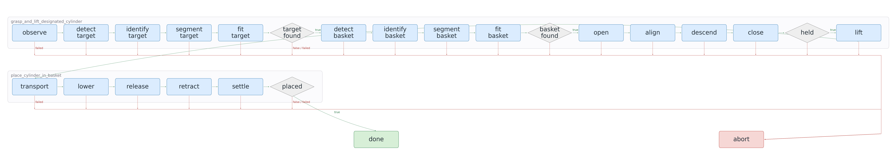

# Graph-as-Policy for Isaac Sim

[](docs/visualizations/grocery-order/grocery-order-process.mp4)

This project is a focused recreation of the **Fulfill Grocery Orders** benchmark,
implementing a Graph-as-Policy controller for deterministic, single-object
grocery pick-and-place with a Franka robot in NVIDIA Isaac Sim. It samples
repeatable scene layouts, represents the task as explicit skill and action nodes
with success/failure routes, runs bounded simulator checks, and records structured
evidence for evaluation. The supporting Python tools also validate configuration
and inspect observations without starting Isaac Sim.

## Setup and basic use

From Windows PowerShell, with Python 3.10 or newer selected, create an
environment and install the package with its development tools:

```powershell
python -m venv .venv
.\.venv\Scripts\Activate.ps1
python -m pip install -e ".[dev]"
```

The main CLI can validate the checked-in YAML, inspect host readiness, and show
the deterministic inputs for an episode without launching the simulator:

```powershell
gap-isaac validate
gap-isaac doctor
gap-isaac sample --seed 0
gap-isaac plan-reset --seed 0 --target alphabet_soup
```

Full simulator workflows are Windows-native. The recorded platform configuration
targets Isaac Sim 6.1.0 and Isaac Lab 2.3.0, expects `ISAAC_SIM_PATH`, and selects
GPU index 0. Run files under `isaac/` with Isaac Sim's `python.bat`, not the
system interpreter; start with `gap-isaac doctor` to see which host settings are
available.

## API graph harness

The optional harness follows the coordinator, per subgraph skill agent and independent
checkpoint agent hierarchy. It keeps every graph revision and returns simulator state,
contact and checkpoint evidence for bounded refinement. Start with the offline check:

```powershell
.\.venv\Scripts\python.exe -m gap_harness.cli check
```

See [the harness guide](harness/README.md) for API opt in, version storage, rehearsal
commands, feedback design and other task manifests. The supplied executable adapter
uses the custom LIBERO grocery task; other tasks require deployed bindings and evaluation.

## Upstream benchmark environments

Official environments are separate from the four custom proxy scenarios. They use
their original BDDL goals and saved initial states, not the custom grocery generator.
Their receipts and captures live under `results/benchmarks/<benchmark>/`; existing
custom harness sessions and visualizations are unchanged.

These selections live in `gap_libero.benchmarks` and reuse the existing LIBERO
configuration writer, capture and graph runner, backend, bounded actions, goal
verification, and recording. They are also accessible through
`python -m gap_libero.cli benchmark list` without a separate runtime implementation.

The implementation stays in the central `gap_libero` modules. The small `benchmarks/`
folder only handles upstream source selection and preparation; capture, graph execution,
bounded controls, perception, evaluation, and recording reuse the existing code.

```powershell
.\scripts\run-benchmark.ps1 -Prepare -Mode list
.\scripts\run-benchmark.ps1
.\scripts\run-benchmark.ps1 -Benchmark libero-pro-object -Prepare
.\scripts\run-benchmark.ps1 -Benchmark libero-pro-swap -Prepare
```

Other original suites are `libero-spatial`, `libero-goal`, `libero-10`, and `libero-90`.
`-TaskId` and `-InitStateId` select official tasks and stored states. A seed does not
replace the initial-state index. Captures do not count as successful evaluations.
The Pro `object` selection changes object appearance or scale; `swap` changes positions.
These names are kept explicit rather than assuming the paper's `object_swap` label
is an identical upstream suite.

LIBERO-Pro uses a pinned separate checkout and configuration with the existing
runtime dependencies. Preparation downloads evaluation files from the official
Hugging Face dataset but no policy weights or demonstrations. No installed LIBERO
package or custom configuration is replaced.

Native LIBERO-Object task zero now has a deployed harness selection, `native-object`.
It reuses the central grocery runner, local Qwen service, RGB-D geometry, and bounded
controls. The target is the textured alphabet-soup can, not the custom blue cylinder.
Ten variation indices select official saved initial states zero through nine of this
single task. This is not a whole-suite score or a held-out generalization test.
Depth-connected regions are filtered by declared shape priors, then Qwen chooses
identities. Simulator poses are used only for grasp and evaluation evidence, never
for motion target selection. The official goal must remain satisfied after release.
Collision guards and the one-thousand-step episode limit remain active during bounded
post-goal release verification. Other native tasks do not yet have automatic bindings.

With Qwen and the Codex proxy running, generation and evaluation use the existing harness:

```powershell
.\.venv\Scripts\python.exe -m gap_harness.cli check --scenario native-object
.\.venv\Scripts\python.exe -m gap_harness.cli iterate --scenario native-object --live --execute --max-attempts 10
```

Existing custom harness manifests do not automatically support the other native environments.
Native graph execution requires a matching bounded `RunPlan` and explicit motion opt in
through `-Mode run -Graph ... -Plan ... -EnableMotion`. The benchmark goal predicate
determines success. Task-specific perception and action bindings must be implemented
before automatic generation and refinement can evaluate these tasks. The paper's
additional grocery, packing, and popcorn environments are not relabeled as official
assets here; the existing approximations remain custom scenarios.

## References

1. K. Chen, S. Xie, L. Fu, J. Yu, W. Pacini, S. Bajamahal, H. Kim, J. Drake,
   D. Kim, H. Xue, J. Francis, C. Juette, P. Schaldenbrand, M. Y. Seker,
   R. Wickramarachchi, U. Yoo, G. Wang, A. Murali, B. Sundaralingam,
   S. S. Sastry, S. Huang, Y. Zhu, L. "Jim" Fan, and K. Goldberg,
   “GaP: A Graph-as-Policy Multi-Agent Self-Learning Harness For Variational
   Automation Tasks,” arXiv:2607.05369, 2026.
   [Paper](https://arxiv.org/pdf/2607.05369) ·
   [Project page](https://graph-robots.github.io/gap)
