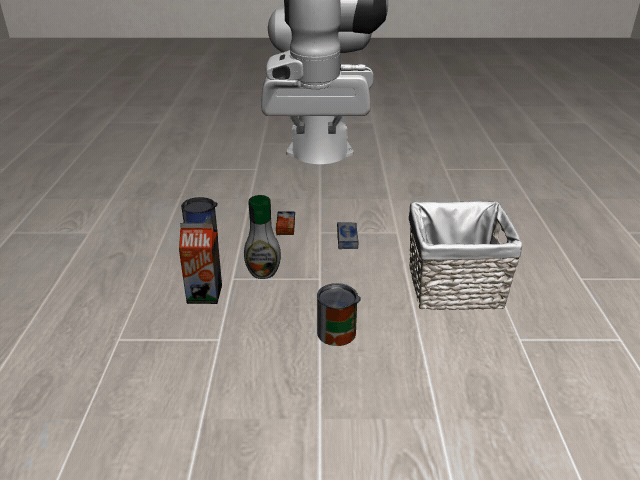

# Completed graph runs

Videos below come from the completed October 19, 2026 graph campaigns. Each process
video shows measured revision scores followed by one recorded final-policy execution.
Robot-only videos contain that execution without the graph dashboard, at recorded
simulator speed. A replay is an illustration, not an additional ten-trial evaluation.

| Scenario | Final score | Attempts | Process video | Robot video | Final graph |
| --- | --- | --- | --- | --- | --- |
| Grocery pick-and-place | 10/10 | 1 | [MP4](grocery-order/grocery-order-process.mp4) | [MP4](grocery-order/grocery-order-robot.mp4) | [PNG](grocery-order/grocery-order-policy.png) |
| Grocery fulfillment | 9/10 | 10 | [MP4](fulfillment/grocery-fulfillment-process.mp4) | [MP4](fulfillment/grocery-fulfillment-robot.mp4) | [PNG](fulfillment/grocery-fulfillment-policy.png) |
| Two-item packing | 10/10 | 2 | [MP4](packing/two-item-packing-process.mp4) | [MP4](packing/two-item-packing-robot.mp4) | [PNG](packing/two-item-packing-policy.png) |
| Popcorn preparation proxy | 10/10 | 1 | [MP4](popcorn/popcorn-preparation-process.mp4) | [MP4](popcorn/popcorn-preparation-robot.mp4) | [PNG](popcorn/popcorn-preparation-policy.png) |
| Native LIBERO-Object task 0 | 10/10 | 1 | [MP4](libero-native-object-local-qwen/libero-native-object-local-qwen-process.mp4) | [MP4](libero-native-object-local-qwen/libero-native-object-local-qwen-robot.mp4) | [PNG](libero-native-object-local-qwen/libero-native-object-local-qwen-policy.png) |

## Robot-motion preview

The GIF shows the complete successful native-task replay at faster playback.
The linked robot MP4 retains recorded simulator timing. GIF frames are sampled,
not interpolated; sparse simulator camera samples are held between observations.

## Evidence and interpretation

[results-summary.json](results-summary.json) records the selected sessions, final
and best versions, measured histories, failed variation indices, graph and task
hashes, recording sources, and robot-video hashes. Raw feedback and receipts remain
under the ignored local `results/` directory; paths in the summary identify those
artifacts but do not make them available in a fresh checkout.

The four custom scenarios approximate tasks rather than reproducing the paper's
original assets. The native score is for one official task across saved initial
states 0–9. All campaign variations were reused during refinement, so these are
not held-out scores or directly comparable to the paper's benchmark percentages.
Fulfillment remains at 9/10 after the ten-candidate limit.
